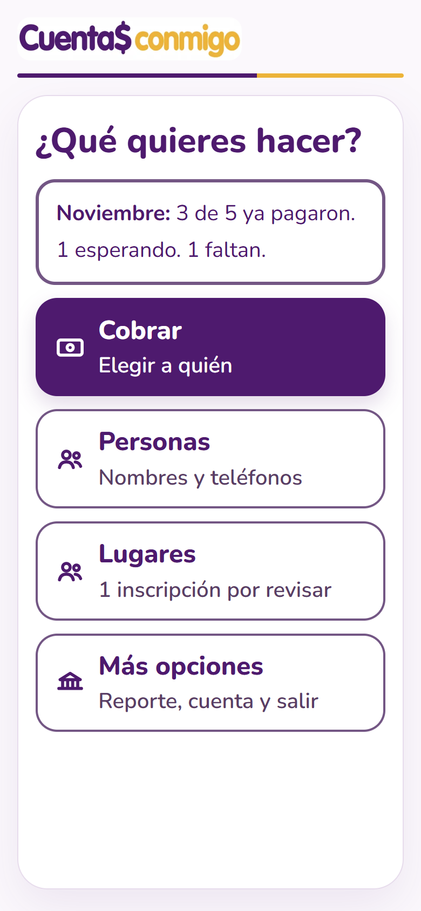
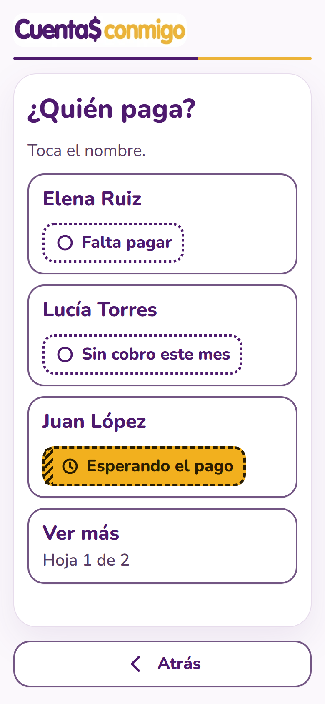
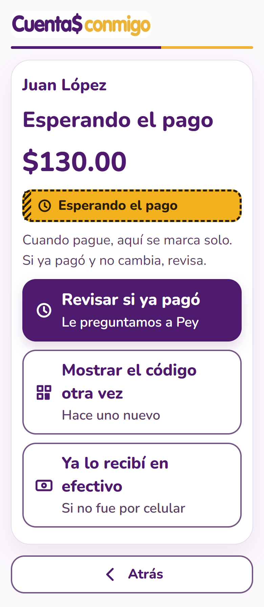
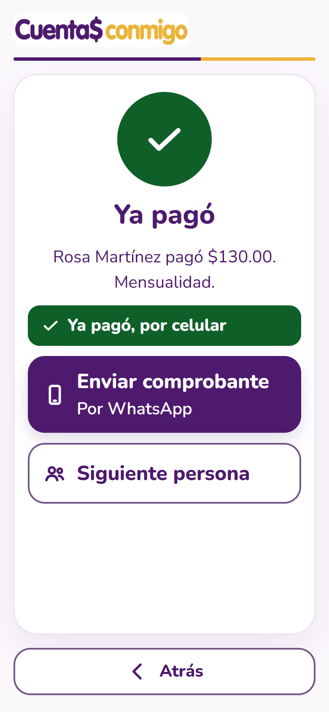
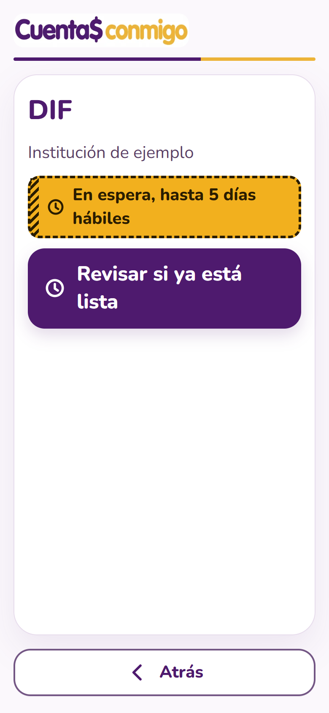

# Cuentas conmigo

Cobros y control de cobros sencillos para adultos mayores, con pagos CoDi a través del API de Pey. Proyecto para el Hackatón México 2026.

La app es de pocos pasos, con letra grande y alto contraste, pensada para personas con poca experiencia tecnológica o problemas de visión. La primera usuaria es una tallerista del DIF que cobra una mensualidad a unas 12 personas desde un iPhone. La misma idea sirve para quien organiza una tanda o para una tienda que fía.

**App en vivo:** https://cuentasconmigo.misspili.com.mx/ (pide crear una cuenta con correo).

## Estado

| Parte | Estado |
| --- | --- |
| Prototipo completo del front (modo sencillo y capa avanzada) | Hecho, en `prototype/` |
| App real: Vite + React + TypeScript | En marcha, en `src/` |
| Servidor en AWS Amplify Gen 2 (acceso, datos, funciones) | Desplegado en us-east-2 |
| Registro de la cuenta que recibe en Pey | Funciona (probado con la CLABE de prueba) |
| Cobro por solicitud CoDi y por QR de CoDi | Se crean en Pey; falta probar un pago real |
| Aviso de pago de Pey (webhook firmado) | Funciona con avisos simulados y firmados; falta registrarlo en Pey |
| Comprobante como imagen, por WhatsApp | Hecho (envío por `wa.me`, compartir imagen y guardar) |
| Cupos, inscripción por QR, reporte mensual | Solo en el prototipo; falta pasarlos a la app real |
| Instalable como app (PWA) y fuentes sin internet | Pendiente |

Lo que ya está probado: un cobro creado en la app aparece como **Pagado** cuando llega un aviso con firma válida, un aviso con firma falsa se rechaza y repetir el mismo aviso no lo duplica. Lo que no está probado: un pago CoDi real de punta a punta, un iPhone real y personas mayores usando la app.

## Pantallas de la app real

Capturas hechas con el modo de demostración (datos inventados, sin servidor), a 390×844 como un iPhone.

| | | |
| --- | --- | --- |
| <br>**1. Inicio** | <br>**2. A quién cobrar** | <br>**3. Cobros de una persona** |
| <br>**4. Cómo cobrar** | <br>**5. Código QR de CoDi** | <br>**6. Esperando el pago** |
| <br>**7. Ya pagó** | <br>**8. Comprobante** | <br>**9. Cuentas que reciben** |
| <br>**10. Cuenta en espera de Pey** | <br>**11. Agregar persona** | <br>**12. Nuevo cobro** |

Cada pantalla tiene un solo botón principal, máximo 4 opciones, texto grande y el estado siempre con ícono, palabras y borde (nada se dice solo con color). El comprobante es una imagen de 1080×1350 con **PAGADO**, el monto grande y los datos del pago.

## Cómo funciona un cobro

1. Quien cobra registra la **cuenta que recibe** (nombre legal del titular y CLABE). Pey la activa con Banxico en hasta 5 días hábiles; mientras tanto solo se puede cobrar en efectivo.
2. Elige a la persona y crea el cobro (monto libre y concepto).
3. Cobra por **solicitud CoDi** al celular de la persona, por **código QR de CoDi** o en **efectivo**.
4. Cuando la persona paga, Pey avisa al servidor con un mensaje firmado. El servidor verifica la firma, marca el cobro como **Pagado** una sola vez y la pantalla se actualiza sola.
5. Quien cobra manda el **comprobante** por WhatsApp o lo guarda como imagen.

Cada cobro manda a Pey el `bankAccountId` de su cuenta, así una sola llave de Pey sirve para varios cobradores (por ejemplo el taller y el DIF).

## Estructura

```
src/                  app real (pantallas, comprobante, modelo de datos)
amplify/              servidor: acceso (Cognito), datos (DynamoDB) y dos funciones
  functions/pey/        llama a Pey: registrar cuenta, solicitud CoDi, QR
  functions/pey-webhook/  recibe el aviso de pago de Pey y verifica la firma
demo/                 modo de demostración con datos inventados (para capturas y diseño)
scripts/              prueba firmada del webhook y capturas de pantalla
prototype/            prototipo completo (modo sencillo y capa avanzada) con sus pruebas
docs/                 arquitectura, auditoría, folleto y capturas
amplify.yml           cómo construye y despliega Amplify
```

## Ejecutar y probar

Necesitas Node.js 22 o más.

```
npm install
npm run dev
```

- **Modo de demostración** (sin servidor ni cuenta): abre `http://localhost:5173/demo/index.html?v=home`. Otras pantallas: `who`, `person`, `charge`, `qr`, `wait`, `paid`, `receipt`, `accounts`, `account`, `add-person`, `new-charge`.
- **Capturas del README:** con `npm run dev` corriendo, `node scripts/screens.cjs` (necesita Google Chrome; `CHROME_PATH` cambia su ubicación).
- **App completa:** necesita `amplify_outputs.json` en la raíz, que Amplify genera al desplegar (descárgalo en la consola de Amplify). No se sube al repositorio.
- **Prueba del webhook sin dinero:** `WEBHOOK_URL=… WEBHOOK_SECRET=… CHARGE_ID=… node scripts/test-webhook.cjs`. Manda un aviso firmado y comprueba que se rechaza uno falso, que uno bueno marca **Pagado** y que repetirlo no duplica.
- **Prototipo:** abre `prototype/paga-con-tu-foto.html`; se reconstruye con `python prototype/source/build.py` y se prueba con `npm run smoke` y `npm run layout` dentro de `prototype/tests` (182 comprobaciones).

## Despliegue

Amplify Hosting construye y despliega solo cada vez que se sube un cambio a `main` (`amplify.yml`). El servidor necesita dos secretos en **Hosting → Secret management** de la app de Amplify:

- `PEY_API_KEY`: la llave de la API de Pey.
- `PEY_WEBHOOK_SECRET`: el secreto `whsec_…` que Pey entrega al registrar la URL del webhook (se registra en portal.mipey.mx → Developers).

Las llaves nunca van en el repositorio ni en el código; el servidor las lee de los secretos. Hay un aviso de presupuesto mensual en la cuenta de AWS.

## Seguridad y privacidad

- El webhook rechaza cualquier aviso sin firma válida (Standard Webhooks) y registra cada pago una sola vez.
- No se envía una solicitud CoDi a una cuenta que Pey todavía no activó.
- El dinero de CoDi no se puede deshacer; solo los pagos en efectivo.
- Los datos de este repositorio (personas, teléfonos, CLABEs) son inventados o son la CLABE de prueba que Pey publica.

## Qué falta

1. Registrar el webhook en Pey y probar un pago real de $0.01.
2. Pasar a la app real los cupos, la inscripción por QR y el reporte mensual, que hoy solo están en el prototipo.
3. Hacerla instalable (PWA), alojar las tipografías y probarla en un iPhone con la primera usuaria.
4. Confirmar con Pey cuántas cuentas admite una llave y si el titular de una cuenta puede ser distinto del dueño de la llave (necesario para la cuenta del DIF).

La arquitectura prevista (Pey, CoDi, Amplify y las reglas de aprobación) está en `docs/ARQUITECTURA.md`.
