# Manual de flujos de «Cuentas conmigo»

Este manual dibuja **cada tarea de principio a fin**, con los nombres que de verdad tienen las pantallas y los botones de la app. Está hecho leyendo el código (`src/`), no de memoria. Los diagramas se ven directamente en GitHub.

**Cómo está organizado**

1. [Quién usa qué](#1-quién-usa-qué): hay dos mundos y conviene no mezclarlos.
2. [Flujos de la persona mayor](#2-flujos-de-la-persona-mayor) (mínimos, con y sin llavero).
3. [Flujos de quien asiste](#3-flujos-de-quien-asiste): cobrar, dar de alta, aprobar inscripciones, editar y corregir, llaveros, baja, cuentas.
4. [Índice «quiero hacer…»](#4-índice-quiero-hacer) para encontrar cualquier tarea en un vistazo.
5. [Dónde alguien se puede perder](#5-dónde-alguien-se-puede-perder): lo que encontré al mapear, con propuestas.

**Cómo leer los diagramas:** los rectángulos son pantallas (el texto es el título que se ve); los óvalos son acciones de una persona; los rombos son decisiones; el color verde es el final bueno y el rojo es un aviso o un callejón con salida.

---

## 1. Quién usa qué

Hay **dos tipos de persona** y la app los trata distinto:

| | **Persona mayor** (quien paga) | **Quien asiste** (quien cobra y configura) |
|---|---|---|
| ¿Tiene cuenta en la app? | **No.** Nunca inicia sesión. | **Sí**: correo y contraseña. |
| ¿Qué toca en la app? | Casi nada: una página pública solo si se inscribe o recibe un enlace. | Todo: cobrar, dar de alta, aprobar, corregir. |
| ¿Cómo paga? | Con su banco (escanea el código QR de CoDi) o en efectivo. Si alguien le ayuda, esa persona recibe el código. | — |
| ¿Qué lleva consigo? | Su **llavero NFC** (opcional). | Su celular con la app. |

**Idea central:** el llavero lo acerca **quien asiste**, con *su* celular, no la persona mayor. Así la persona mayor no necesita saber usar ninguna app.

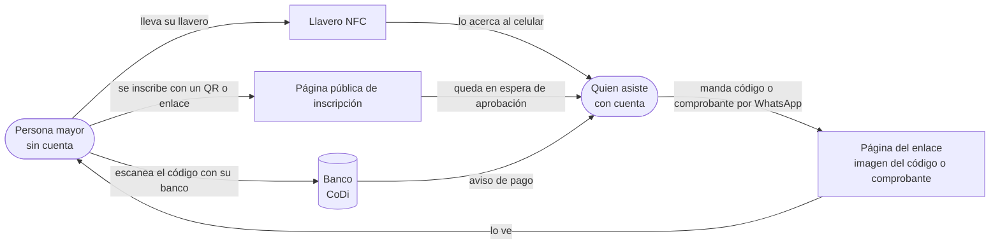

---

## 2. Flujos de la persona mayor

Lo que hace la persona mayor es **mínimo**: mostrar el llavero (o decir su nombre) y pagar. Todo lo demás lo hace quien asiste.

### 2.1 Pagar su mensualidad, **con llavero NFC**

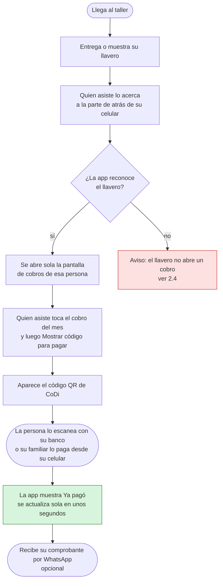

Lo que hace la persona mayor: **1)** muestra el llavero, **2)** paga con su banco o en efectivo. Nada más.

### 2.2 Pagar su mensualidad, **sin llavero**

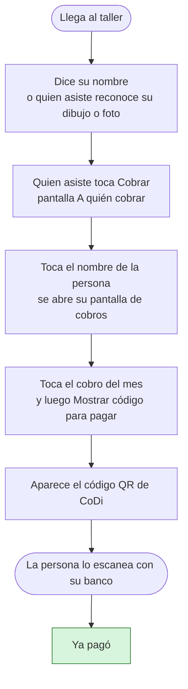

Desde el punto de la pantalla *Cobros de una persona*, **los dos caminos son idénticos**: el llavero solo se ahorra los dos primeros toques de quien asiste.

### 2.3 Inscribirse sola, con un código QR o un enlace

La persona (o quien le ayuda) abre el QR o el enlace que quien asiste le dio. No necesita cuenta.

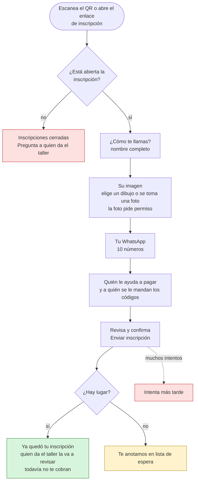

La inscripción **solo registra**: no manda cobros ni mensajes. Nada pasa hasta que quien asiste la aprueba (ver 3.3).

### 2.4 Cuando el llavero no abre un cobro

El aviso lo ve **quien asiste** (no la persona mayor), y siempre tiene una salida clara.

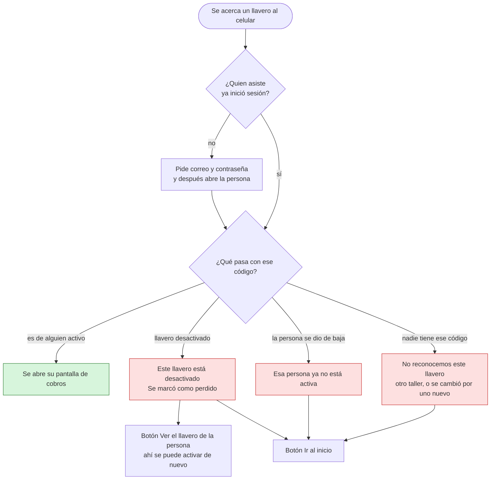

> Por probar en un teléfono real: el paso «pide correo y contraseña y después abre la persona» se deduce del código (la dirección del llavero se conserva durante el inicio de sesión), pero no se ha visto funcionar.

### 2.5 Si quien paga es un familiar (quien ayuda)

Algunas personas no pagan ellas mismas: les ayuda otra persona. La app lo guarda al dar de alta (hasta 3 personas, con nombre y relación) y la persona elige **a quién** se le manda todo.

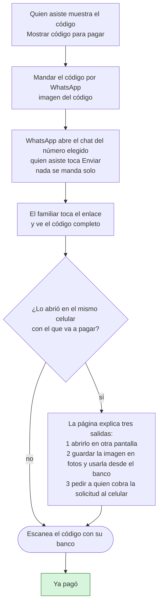

---

## 3. Flujos de quien asiste

### 3.0 Mapa de la app: de dónde sale cada cosa

Todo parte de **Inicio** (el de cada proyecto). Hay solo **cuatro entradas** y una cuenta aparte.

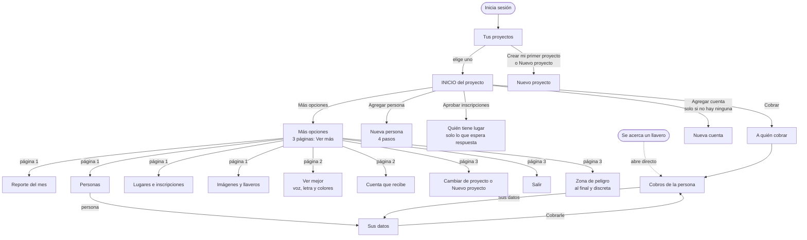

**Cobros y datos de una persona están conectados en los dos sentidos:** desde *Cobros de la persona* hay un botón **Sus datos**, y desde *Sus datos* hay un botón **Cobrarle**. No hace falta salir a *Más opciones* para corregir algo en medio de un cobro.

**Regla del mapa:** *cobrar a alguien* tiene tres entradas (Cobrar, Sus datos → Cobrarle, o el llavero), pero **las tres llegan a la misma pantalla** (*Cobros de la persona*) y de ahí el camino es uno solo.

### 3.1 Primera vez: dejar la app lista para cobrar

Se hace **una sola vez**. Sin cuenta que reciba, solo se puede anotar efectivo.

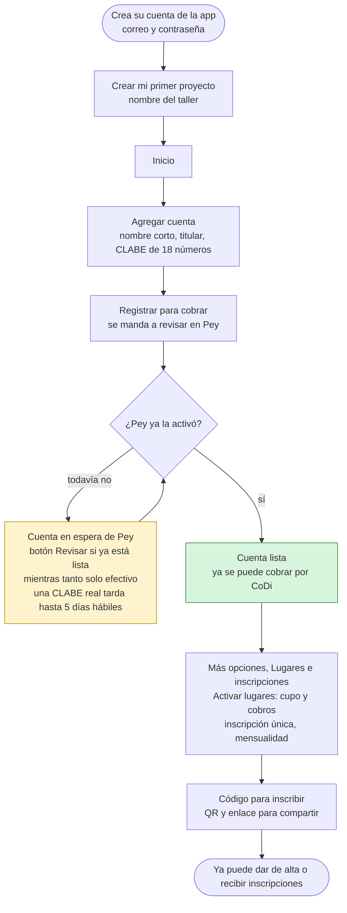

### 3.2 Realizar un cobro (el flujo principal)

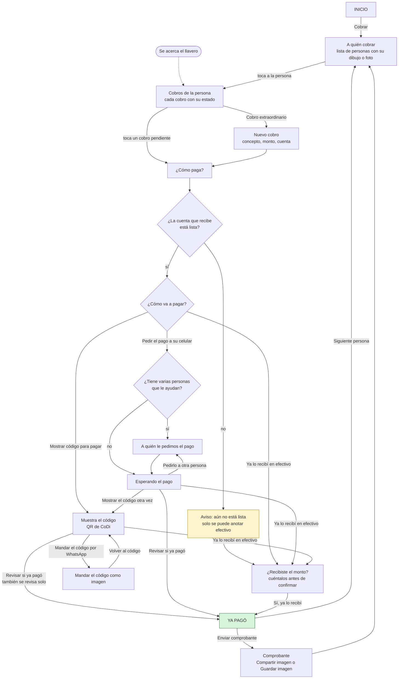

#### Corregir un cobro

Un cobro se puede corregir (el monto y para qué es) **mientras no se haya mandado a pagar**. Una vez mandado, el código **caduca a las 24 horas** (lo que dura el QR en Pey) y solo entonces se puede volver a corregir.

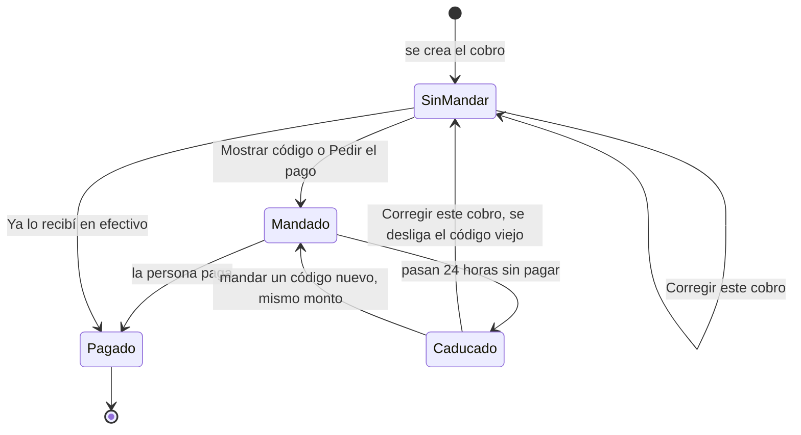

- **Dónde:** *¿Cómo paga?* → **Corregir este cobro** (el botón solo aparece cuando se puede). Si ya se mandó, la pantalla dice hasta qué hora sirve el código.
- **Los cobros que vienen del plan del proyecto** (inscripción, mensualidad) solo permiten cambiar el **monto**: la app los reconoce por su nombre y, si se cambiara, volvería a ofrecer el cobro del mes como pendiente.
- **Protección del dinero:** si alguien paga un código viejo después de que el cobro se corrigió con otro monto, el aviso de Pey **no lo marca como pagado** (queda registrado en el servidor para revisarlo en Pey). Así el monto que figura nunca difiere del que se pagó.
- La cuenta que recibe no se cambia en un cobro ya creado.

**Qué hay que saber:**
- **El código QR es la vía principal.** La solicitud al celular a veces no llega a todos los bancos (lo dice la propia pantalla).
- El pago **se detecta solo**: la app revisa cada pocos segundos y pasa sola a *Ya pagó* cuando Pey avisa. El botón *Revisar si ya pagó* es por si el aviso se perdió.
- El **efectivo** siempre está disponible y pide confirmar el monto antes de guardarlo. El dinero de CoDi no se puede deshacer; el efectivo sí.
- Si algo falla, aparece un cuadro rojo con el motivo en palabras claras y tres salidas: *Intentar de nuevo*, *Volver* o *Ir al inicio*.

### 3.3 Dar de alta una persona nueva

Hay **dos formas** de que una persona entre a la lista. Ambas terminan en lo mismo: una persona activa con su imagen.

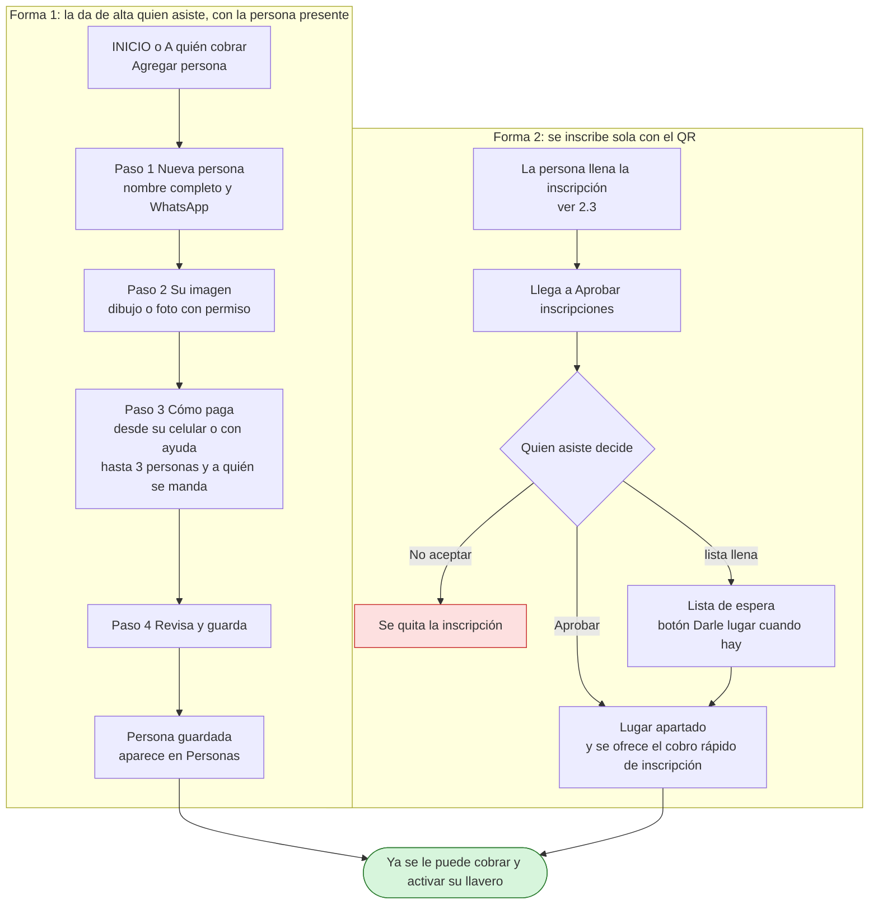

Tras **aprobar**, el lugar queda apartado un número de días. Mientras no pague, el cobro sigue pendiente; cuando pasa el plazo, quien asiste decide entre **Dejar N días más** y **Dar de baja**:

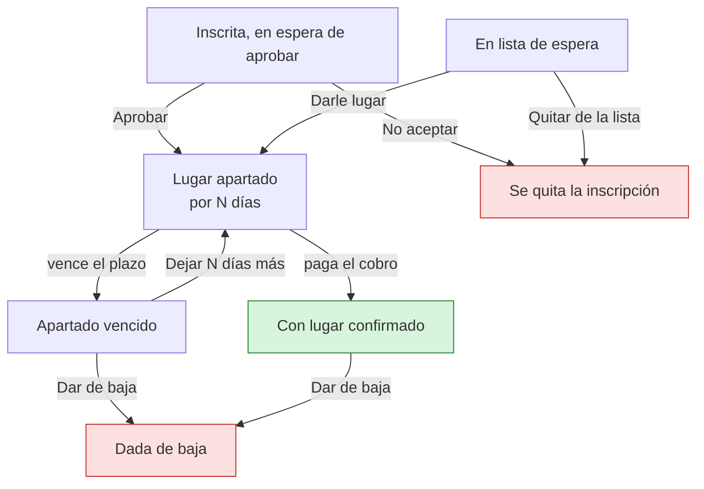

### 3.4 Editar a una persona y corregir datos

**Una sola pantalla de correcciones: *Sus datos*.** Se llega desde *Más opciones → Personas → (la persona)* o con el botón **Sus datos** dentro de los cobros de la persona. De ahí salen todas las correcciones y también **Dar de baja**.

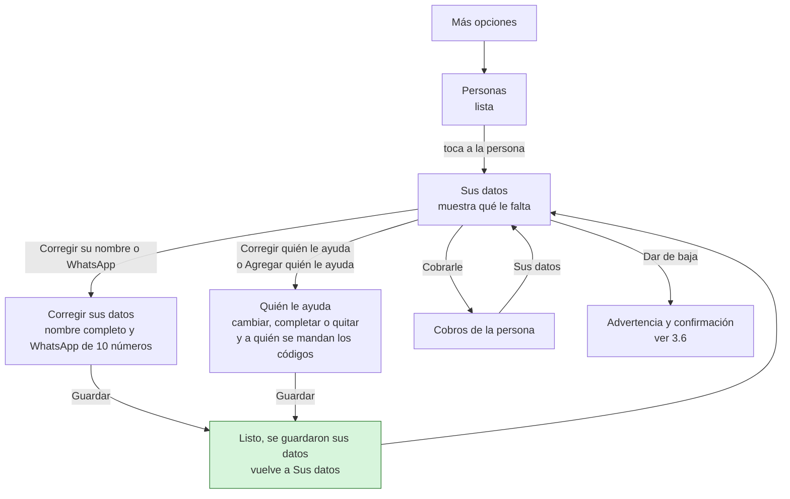

**Qué se puede y qué no se puede corregir hoy:**

| Dato | ¿Se puede corregir? | Dónde |
|---|---|---|
| Nombre y WhatsApp de la persona | Sí | *Cobros de la persona* o *Más opciones → Personas* → **Sus datos** → *Corregir su nombre o WhatsApp* |
| Quién le ayuda, su relación y a quién se mandan los códigos | Sí | Sus datos → *Corregir quién le ayuda* |
| A quién se le pide el pago de **un cobro** | Sí | En el cobro → *Pedir el pago por CoDi* → *A quién le pedimos el pago* |
| Su dibujo o foto | **No** (solo se elige un dibujo si aún no tiene) | Imágenes y llaveros → la persona → *Elegir un dibujo* |
| Monto y concepto de un cobro (en los del plan, solo el monto) | **Sí**, si no se ha mandado a pagar o si su código ya caducó (24 h) | En el cobro → *Corregir este cobro* (ver 3.2) |
| La cuenta que recibe | Se puede registrar de nuevo en Pey o eliminar | Más opciones → *Cuenta que recibe* |

### 3.5 Llaveros NFC: activar, programar, perder, reemplazar

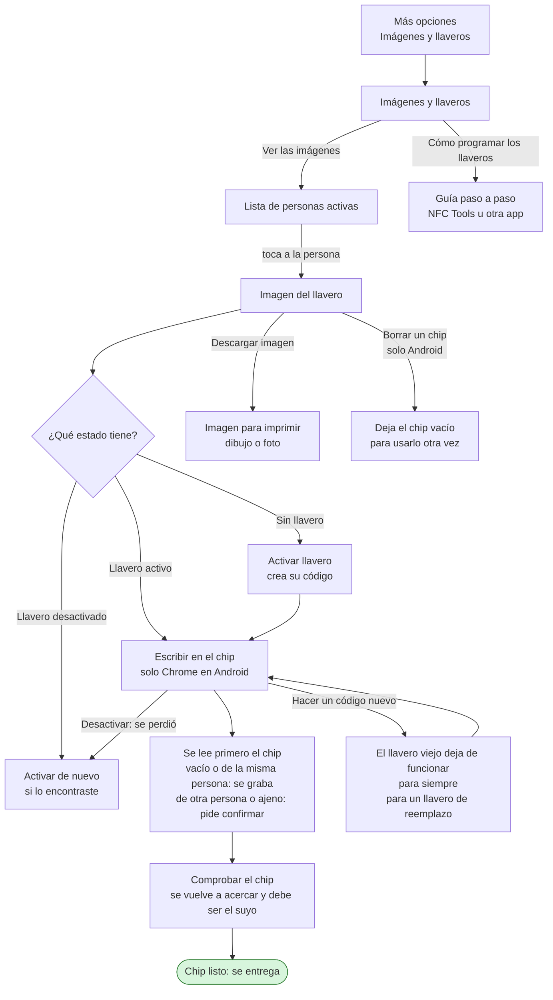

**Si el celular no puede escribir NFC** (iPhone): la pantalla lo dice y manda a la guía manual. La opción práctica es programar los chips una sola vez con un Android; **leerlos** en iPhone funciona normal.

### 3.6 Dar de baja a una persona

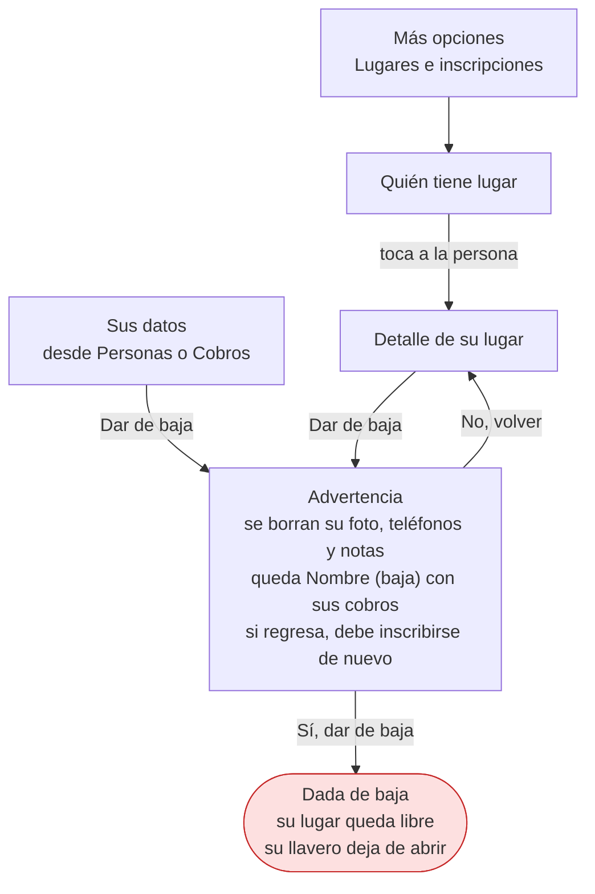

> **Borrar de verdad** (todas las personas y cobros) existe, pero está lejos y escondido a propósito: *Más opciones → Zona de peligro*, con código que llega al correo.

### 3.7 Reporte del mes

*Más opciones → Reporte del mes* → ver el mes → **Mes anterior / Mes siguiente** → **Guardar como hoja de cálculo**. Muestra cada persona con lo pagado por CoDi y en efectivo.

---

## 4. Índice «quiero hacer…»

Cada tarea **empieza en un solo lugar**. Si hay otro camino, termina en la misma pantalla.

| Quiero… | Empiezo en… | Pasos | Diagrama |
|---|---|---|---|
| **Cobrarle a alguien** | Inicio → **Cobrar** (o acercar su llavero) | Persona → cobro → ¿Cómo paga? → código / celular / efectivo → Ya pagó | 3.2 |
| **Cobrar algo extra** (cooperación) | Cobros de la persona → **Cobro extraordinario** | Concepto y monto → ¿Cómo paga? | 3.2 |
| **Mandar el código o el comprobante** | En el cobro: **Mandar el código por WhatsApp** / **Enviar comprobante** | WhatsApp abre el chat; tú tocas Enviar | 2.5 |
| **Dar de alta a alguien presente** | Inicio → **Agregar persona** | 4 pasos | 3.3 |
| **Que alguien se inscriba solo** | Más opciones → Lugares e inscripciones → **Código para inscribir** | Mandar el enlace; esperar; aprobar | 2.3, 3.3 |
| **Aprobar una inscripción** | Inicio → **Aprobar inscripciones** (aparece con 🔔) | Aprobar / No aceptar | 3.3 |
| **Corregir nombre o teléfono** | **Sus datos** (botón en los cobros de la persona, o Más opciones → Personas → persona) → **Corregir su nombre o WhatsApp** | Guardar | 3.4 |
| **Corregir un cobro** (monto o para qué es) | En el cobro → **Corregir este cobro** | Solo si no se mandó a pagar o ya caducó (24 h) | 3.2 |
| **Cambiar quién le ayuda a pagar** | Más opciones → Personas → persona → **Corregir quién le ayuda** | Guardar | 3.4 |
| **Pedir el pago a otra persona de la familia** | En el cobro → **Pedir el pago por CoDi** → **A quién le pedimos** | Elegir | 3.2 |
| **Activar o programar un llavero** | Más opciones (página 1) → **Imágenes y llaveros** → persona | Activar → Escribir en el chip → Comprobar | 3.5 |
| **Reportar un llavero perdido** | Imágenes y llaveros → persona → **Desactivar: se perdió** | Después, **Hacer un código nuevo** para el reemplazo | 3.5 |
| **Dar de baja** | **Sus datos** → **Dar de baja** (o Lugares e inscripciones → Quién tiene lugar → persona) | Confirmar | 3.6 |
| **Registrar o cambiar la cuenta que recibe** | Más opciones → **Cuenta que recibe** | Registrar para cobrar → Revisar si ya está lista | 3.1 |
| **Ver cuánto se cobró** | Inicio (arriba) o Más opciones → **Reporte del mes** | Guardar como hoja de cálculo | 3.7 |
| **Cambiar de taller** | Más opciones → **Cambiar de proyecto** | Elegir | 3.0 |

---

## 5. Dónde alguien se puede perder

Al mapear todo encontré estos puntos. **Son hallazgos de lectura del código; ninguno está probado en un celular.** Los marcados ✅ ya se arreglaron en la app.

| # | Dónde | Qué pasaba | Estado |
|---|---|---|---|
| 1 | *Cobros de la persona* → corregir su teléfono | No había camino directo a *Sus datos*. | ✅ Botón **Sus datos** en los cobros de la persona. |
| 2 | *Sus datos* → imagen | No se puede cambiar el dibujo ni la foto de una persona ya creada. | Pendiente: agregar **«Cambiar su imagen»** (reusa el selector que ya existe). |
| 3 | Cobros | No se podía corregir el monto o el concepto de un cobro. | ✅ **Corregir este cobro**, con la regla de las 24 horas (ver 3.2). |
| 4 | Dar de baja | *Personas* decía «bajas» pero la baja no estaba ahí. | ✅ **Dar de baja** dentro de *Sus datos*, con la misma advertencia. |
| 5 | *Más opciones* | Los llaveros estaban en la segunda página. | ✅ *Imágenes y llaveros* ahora está en la página 1; la 2 queda con *Ver mejor* y *Cuenta que recibe*. |
| 6 | Llavero desactivado | El aviso ofrece **Ver el llavero**, pero no explica que ahí se activa de nuevo. | Pendiente: cambiar el texto del botón a **«Ver el llavero y activarlo de nuevo»**. |
| 7 | iPhone | Escribir chips no funciona desde la web; la pantalla lo dice pero no menciona el camino alterno. | Ya se avisa; si se decide app nativa para iPhone, este flujo se reemplaza. |

**Lo que sí está bien resuelto** (conviene no tocarlo): todos los caminos de cobro convergen en *Cobros de la persona*; el efectivo siempre está a un toque; el pago se detecta solo; los errores dicen el motivo y dan tres salidas; el borrado definitivo es difícil de tocar por error; la inscripción pública no puede cobrar.

---

## Cómo mantener este manual

Los diagramas son texto (Mermaid) en este mismo archivo, así que se versionan con el código. **Cuando cambie una pantalla o un botón, se actualiza aquí en el mismo pull request.** Si algo de este manual no coincide con la app, la app manda: avísame y se corrige.
